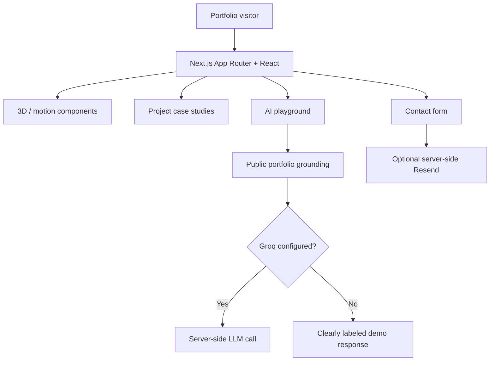

<div align="center">

# Faizan AI Portfolio
### An interactive portfolio for real-world AI engineering

**Next.js · React · TypeScript · Motion · 3D · Optional server-side AI**


[Quick start](#quick-start) · [Architecture](#architecture) · [Features](#features) · [Deployment](#deployment)

</div>

## What is this?

A **dark-first interactive developer portfolio** focused on AI systems, case studies and hands-on demonstrations. The UI includes a neural-field visual, project presentations and an AI playground. External AI replies and contact-form delivery are **optional**, server-side integrations and are not required to explore the frontend.

> **Repository layout:** The runnable Next.js application is currently inside [`faizan-ai-portfolio/`](faizan-ai-portfolio/), one level below this repository's root. The root also contains a copy of the tool configuration. Run application commands from the **nested folder**, not the repository root.

## Architecture



## Features

| Experience | Implementation |
| --- | --- |
| Visual design | Responsive dark-first layout, neural illustration and reduced-motion support |
| Projects | Curated AI case studies and technical context |
| AI playground | Public-content responses, retrieval and agent-execution demos |
| AI integration | Optional Groq Chat Completions endpoint, server-side only |
| Contact | Optional Resend-backed form plus direct email link |
| Discoverability | SEO metadata, sitemap, robots and social sharing image |
| Quality | Content/structure tests and local tooling commands |

Visual simulations in the playground are explicitly **demonstrations**, not traces of a live production agent.

## Quick start

**Requirements:** Node.js 20.11+ and npm.

```bash
git clone https://github.com/FaizanAKhan786/faizan-ai-portfolio.git
cd faizan-ai-portfolio/faizan-ai-portfolio
npm install
cp ../.env.example .env.local
npm run dev
```

Open [localhost:3000](http://localhost:3000). The homepage and demos can be explored without API keys.

If you need real AI responses, configure `GROQ_API_KEY` **server-side** in `.env.local`. For the contact form, set `RESEND_API_KEY`, `CONTACT_FROM_EMAIL` (verified sender) and `CONTACT_TO_EMAIL`. Avoid putting secrets in any `NEXT_PUBLIC_*` variable.

## Development

Run inside the nested `faizan-ai-portfolio/` application directory:

```bash
npm run typecheck
npm run lint
npm test
npm run build
```

Edit portfolio data in [`faizan-ai-portfolio/content/portfolio.ts`](faizan-ai-portfolio/content/portfolio.ts). Components are under [`faizan-ai-portfolio/components/`](faizan-ai-portfolio/components/), with routes and API handlers under [`faizan-ai-portfolio/app/`](faizan-ai-portfolio/app/).

## Deployment

Deploy the **nested app directory** as the service root and build with `npm run build`. Set `NEXT_PUBLIC_SITE_URL` to the real deployed HTTPS origin before release. The repository contains deployment starter configuration, but **source code and configuration alone are not confirmation of a working public deployment**.

Before accepting significant public traffic, add distributed rate limiting and anti-abuse protection, check vendor privacy disclosures, test the production build, and verify that the contact sender is permitted by your email provider.

[Issues](https://github.com/FaizanAKhan786/faizan-ai-portfolio/issues) · [GitHub profile](https://github.com/FaizanAKhan786)
