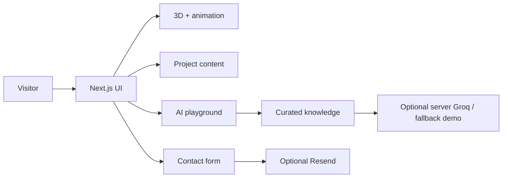

<div align="center">

# Faizan AI Portfolio | Application
### Interactive AI engineering showcase

**Next.js 15 · React 19 · TypeScript · React Three Fiber · Framer Motion**

[Overview](../README.md) · [Getting started](#local-development) · [Architecture](#architecture) · [Application source](https://github.com/FaizanAKhan786/faizan-ai-portfolio/tree/main/faizan-ai-portfolio)

</div>

## About this folder

This directory contains the **runnable Next.js application**. The repository also has a top-level `package.json`, but the `app/`, `components/` and `content/` directories used by Next.js are located **here**.

For the full product description, hosting caveats and environment guidance, see [the root README](../README.md).

## Architecture



## Local development

From the repository root:

```bash
cd faizan-ai-portfolio
npm install
cp ../.env.example .env.local
npm run dev
```

Browse to [http://localhost:3000](http://localhost:3000). Without external API keys, the interactive UI and clearly labeled demo experiences are still available.

Optional settings:
- `GROQ_API_KEY` enables model-backed chat using a server-side API route.
- `RESEND_API_KEY`, `CONTACT_FROM_EMAIL` and `CONTACT_TO_EMAIL` are required for genuine form delivery.
- `NEXT_PUBLIC_SITE_URL` sets the canonical deployed URL.

Never expose AI or email API secrets in `NEXT_PUBLIC_*` variables.

## Checks

```bash
npm run typecheck
npm run lint
npm test
npm run build
```

These are available scripts, **not a claim that all checks passed in this environment**.

| Area | Location |
| --- | --- |
| Routes and server APIs | [`app/`](app/) |
| UI sections | [`components/`](components/) |
| Public portfolio information | [`content/portfolio.ts`](content/portfolio.ts) |
| Helper functions | [`lib/`](lib/) |
| Static assets | [`public/`](public/) |
| Tests | [`tests/`](tests/) |

## Deployment

Set this folder as the host's **root directory**, then build with `npm run build` and start with `npm start`. Configure the environment variables on the host, verify the public URL, and review privacy/rate-limiting considerations before enabling real AI or messaging.

[Back to the main README](../README.md)
